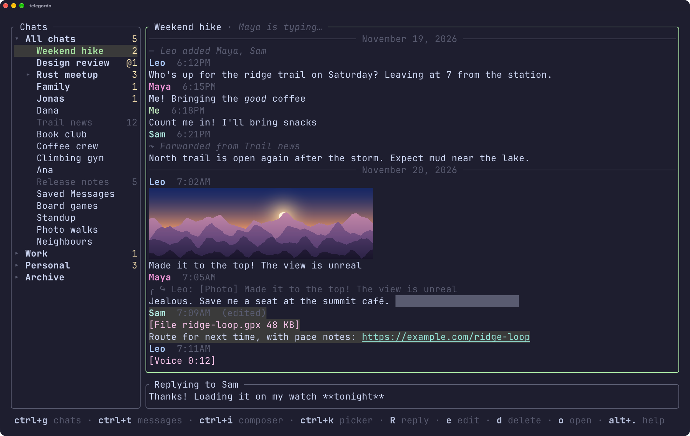
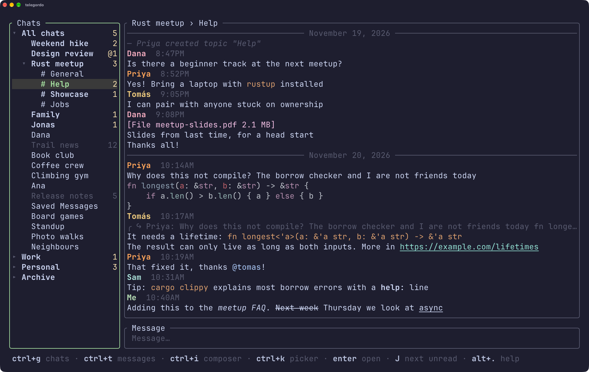
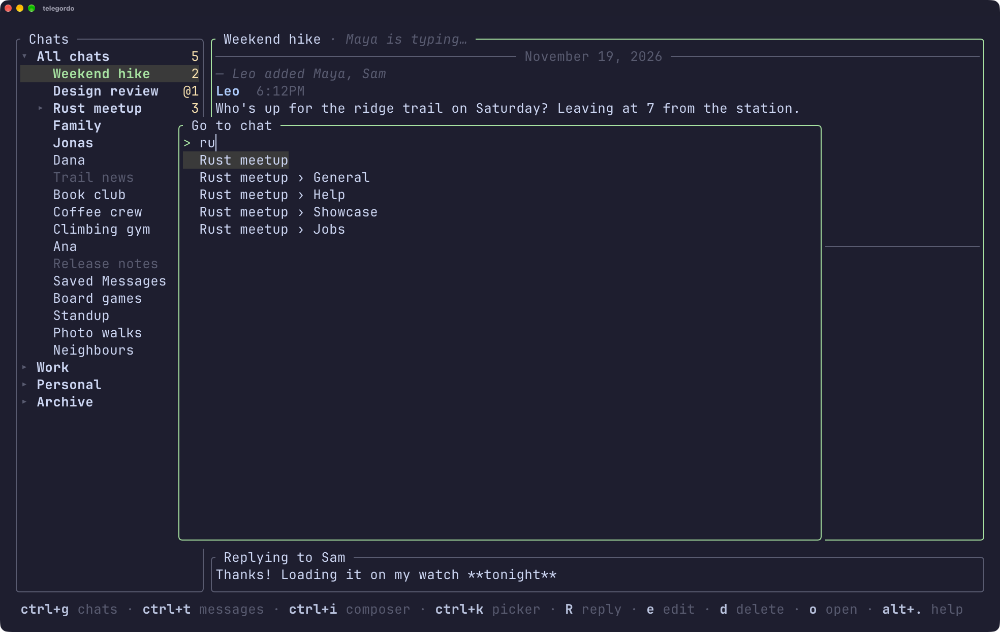

# telegordo

A Telegram client for the terminal that copies the look and workflow of
[discordo](https://github.com/ayn2op/discordo): a chat tree on the left, the
message list in the middle, a composer under it, rounded titled borders, vim
keys and a `ctrl+k` quick switcher.

It is a full user client (your own account, not a bot), built on
[TDLib](https://core.telegram.org/tdlib) through
[tdlib-rs](https://github.com/FedericoBruzzone/tdlib-rs) and drawn with
[ratatui](https://ratatui.rs).



Colors come from your terminal's palette. These screenshots use Ghostty with
the Catppuccin Mocha theme.

## Features

- Chat tree: **All chats**, your chat folders and **Archive**. Chats appear in
  Telegram's order (pinned first), with unread and @mention badges, and muted
  chats are dimmed. Forum groups expand into their topics.
- Message list:
  - Telegram formatting: bold, italic, underline, strikethrough, spoilers
    (masked), inline code, and highlighted code blocks.
  - Links and mentions, date separators, replies with a quote line,
    forwarded-from lines, `(edited)` markers and service messages.
  - Messages from the same sender within 5 minutes are grouped.
- **Inline images**: photos and static stickers render in the terminal.
  kitty, iTerm2 and sixel graphics are used where the terminal supports them,
  with a halfblock fallback everywhere else.
- Other media show as placeholders (`[Video 0:32]`, `[Voice 0:12]`,
  `[File report.pdf 2.1 MB]`). `o` opens the file and `D` saves it to
  `~/Downloads`.
- Composer:
  - Sending uses markdown (`**bold**`, `__italic__`, `~~strike~~`,
    `||spoiler||`, `` `code` ``, fenced code, `[text](url)`).
  - Reply, edit and delete (with a confirmation). `up` in an empty composer
    edits your last message, and `ctrl+e` writes the message in `$EDITOR`.
  - Typing indicators work in both directions.
- Quick switcher (`ctrl+k`): fuzzy search across chats and loaded topics.
- Desktop notifications for new messages while the terminal is unfocused.
- Mouse support: clicking selects, and the wheel scrolls.
- Login by phone number, code and two-step password, or by QR code.
- The session database is encrypted with a random key stored in the OS
  keyring (macOS Keychain, Secret Service on Linux).

| Forum topics and code blocks | Quick switcher (`ctrl+k`) |
| --- | --- |
|  |  |

See [ROADMAP.md](ROADMAP.md) for what is not built yet.

## Install

Requires a recent stable Rust (developed with 1.100; Rust 2024 edition). The
build downloads a prebuilt TDLib 1.8.61 and links it statically, so the binary
only needs system libraries.

```sh
git clone https://github.com/fabianwgl/telegordo.git && cd telegordo
cargo install --path .
```

## Setup: Telegram API credentials

Telegram requires every client to have an `api_id` and `api_hash`. telegordo
ships none, so you use your own:

1. Log in at <https://my.telegram.org> and open **API development tools**.
2. Create an app. The name and platform don't matter.
3. Either export the two values:

   ```sh
   export TELEGORDO_API_ID=12345
   export TELEGORDO_API_HASH=0123456789abcdef0123456789abcdef
   ```

   or put them in the config file:

   ```toml
   [telegram]
   api_id = 12345
   api_hash = "0123456789abcdef0123456789abcdef"
   ```

Then run `telegordo` and log in. On the phone screen, `tab` switches to QR
login: in the Telegram app on your phone, go to Settings → Devices → Link
Desktop Device and scan the code.

## Keys

`alt+.` shows every binding inside the app. The defaults follow discordo:

| Where | Keys |
|---|---|
| Global | `ctrl+g` chats · `ctrl+t` messages · `ctrl+i` composer · `ctrl+h`/`ctrl+l` previous/next pane · `alt+g` toggle sidebar · `ctrl+k` picker · `ctrl+z` suspend · `ctrl+d` log out · `ctrl+c` quit |
| Chats | `j`/`k` move · `g`/`G` top/bottom · `enter` open/expand · `-` collapse parent · `_` collapse all · `p` parent · `J`/`K` next/previous unread · `i` copy ID |
| Messages | `j`/`k` select · `g`/`G` top/bottom · `J`/`K` scroll · `s` go to replied message · `r`/`R` reply · `e` edit · `d` delete · `o` open attachment · `D` download · `y` copy text · `u` copy link · `i` copy ID · `esc` clear selection |
| Composer | `enter` send · `shift+enter` newline · `esc` cancel reply or edit, or clear · `up` edit last message · `ctrl+e` open `$EDITOR` |
| Picker | type to filter · `ctrl+p`/`ctrl+n` up/down · `enter` open · `esc` close |

**Terminal note:** `ctrl+i`, `ctrl+h` and `shift+enter` need a terminal with
the kitty keyboard protocol (kitty, Ghostty and WezTerm have it). Without it,
a terminal cannot tell these keys from Tab, Backspace and Enter. In that case
telegordo switches to `alt+i`, `alt+h`, `alt+l` and `alt+enter`, and the help
bar shows the keys in use. tmux does not pass the protocol through, even with
`extended-keys on`, so the `alt+` keys apply inside tmux. The log file records
which mode was picked.

## Configuration

The config file is optional. Every key has a default, and you only write the
ones you want to change. It is read from:

1. `$XDG_CONFIG_HOME/telegordo/config.toml`, if that variable is set
2. `~/.config/telegordo/config.toml` (on macOS too)
3. macOS: `~/Library/Application Support/telegordo/config.toml`
4. or the path given to `--config-path`

The first file that exists wins.

```toml
mouse = true
editor = "default"        # "default" = $VISUAL, then $EDITOR, then vi
messages_limit = 50       # history page size, 1..=100

[telegram]
api_id = 12345
api_hash = "..."
keyring = true            # false = keep the DB key in a 0600 file in the data dir
use_test_dc = false

[timestamps]
enabled = true
format = "%-I:%M%p"       # chrono strftime

[date_separator]
enabled = true
format = "%B %-d, %Y"

[markdown]
enabled = true
mask_spoilers = true
theme = "base16-ocean.dark"   # syntect theme for code blocks

[notifications]
enabled = true
when_unfocused = true

[typing_indicator]
send = true
receive = true

[sidebar]
width_percent = 20

[images]
enabled = true
protocol = "auto"         # auto, kitty, iterm2, sixel, halfblocks
max_width = 40            # cells
max_height = 12

[theme]
border = "round"          # round, plain, thick, double, hidden
active_border_color = "green"
inactive_border_color = "darkgray"
title_color = "reset"
selected_bg = "#3a3a3a"
timestamp_color = "darkgray"
unread_color = "yellow"

# Rebind any action: one key or a list. Action names are listed by alt+. in the app.
[keys.global]
quit = ["ctrl+q", "ctrl+c"]

[keys.messages]
reply = "r"
```

## Files

- Session database and downloaded files:
  - macOS: `~/Library/Application Support/telegordo/`
  - Linux: `~/.local/share/telegordo/`
  - or the path given to `--data-dir`
- Logs, replaced on each run: `telegordo.log` (this app) and `tdlib.log`
  (TDLib), both in the platform cache directory.
  - Change the app log with `--log-path` and `--log-level debug|info|warn|error`.

`ctrl+d` logs out. That removes the session from Telegram, deletes the local
database and deletes its key from the keyring.

## Development

```sh
cargo test
cargo clippy --all-targets -- -D warnings
```

macOS asks for Keychain access again after every rebuild, because unsigned
binaries change identity with each build. Set `keyring = false` under
`[telegram]` in a dev config to avoid the prompts.

`scripts/screenshots.sh` regenerates the screenshots in `docs/screenshots/`.
An ignored test (`src/screenshots.rs`) draws the real UI with made-up chats.
The script replays each frame in a Ghostty window and captures that window.
No Telegram account is used. The script needs macOS, Ghostty and Screen
Recording permission for your terminal.

## License

MIT. See [LICENSE](LICENSE).
